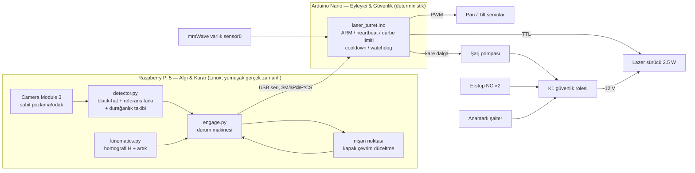
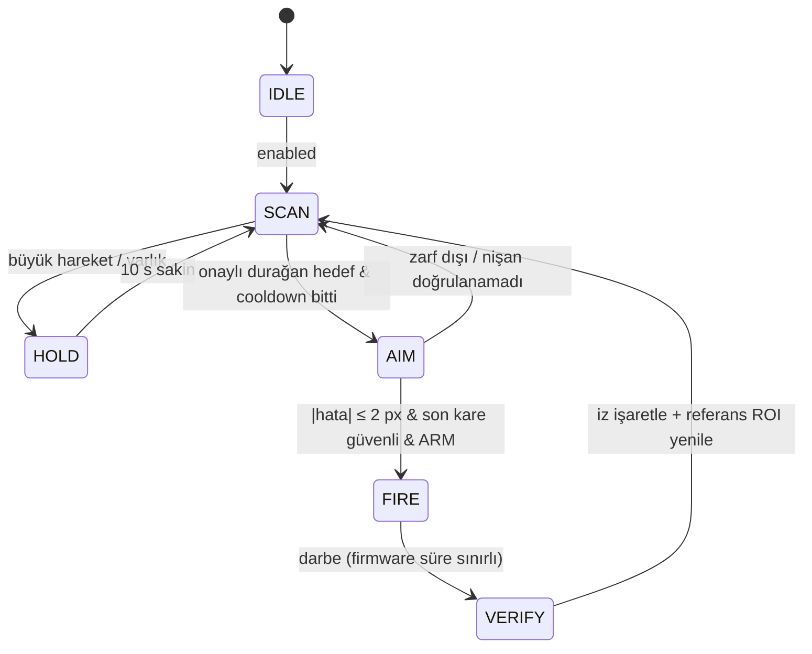

# Otonom Lazerli Sinek İmha Prototipi
### Pan-Tilt Tabanlı Sabit Hedef Sistemi — Uçtan Uca Teknik Proje Dokümanı

> ⚠️ **SINIF 4 LAZER UYARISI.** 2.5 W, 450 nm bir lazer; doğrudan ışın, aynasal yansıma ve
> yakın mesafeden **dağınık (diffuse) yansıma** ile kalıcı göz hasarı, cilt yanığı ve
> yangın tehlikesi oluşturur. Bu doküman bir **prototip / araştırma** kılavuzudur. Lazer gücü,
> sistem; [§5 Güvenlik](#5-kalibrasyon-ve-güvenlik-prosedürleri) bölümündeki donanım kilitleri
> kurulmadan, sertifikalı göz koruması takılmadan ve kontrollü test alanı hazırlanmadan
> **asla** bağlanmamalıdır. Kullanmadan önce bulunduğunuz ülkenin lazer cihazları mevzuatını
> kontrol edin.

---

## İçindekiler
0. [Sistem Özeti ve Mimari](#0-sistem-özeti-ve-mimari)
1. [Kapsamlı Malzeme Listesi (BOM)](#1-kapsamlı-malzeme-listesi-bom)
2. [Devre Bağlantısı ve Elektronik Mimari](#2-devre-bağlantısı-ve-elektronik-mimari)
3. [Simülasyon ve Test Ortamı](#3-simülasyon-ve-test-ortamı)
4. [Yazılım Mimarisi ve Kodlar](#4-yazılım-mimarisi-ve-kodlar)
5. [Kalibrasyon ve Güvenlik Prosedürleri](#5-kalibrasyon-ve-güvenlik-prosedürleri)
6. [Devreye Alma Kontrol Listesi ve Yol Haritası](#6-devreye-alma-kontrol-listesi-ve-yol-haritası)

### Depo yapısı

```
sinek-lazer/
├── README.md                      ← bu doküman
├── firmware/laser_turret/
│   └── laser_turret.ino           ← Arduino Nano: servo + lazer + güvenlik kilitleri
├── software/
│   ├── flylaser/
│   │   ├── detector.py            ← OpenCV hedef tespiti + nişan noktası tespiti
│   │   ├── kinematics.py          ← piksel → pan/tilt (homografi + artık düzeltme)
│   │   ├── engage.py              ← kalibrasyon rutinleri + angajman durum makinesi
│   │   └── turret.py              ← seri protokol + SerialTurret sürücüsü
│   ├── sim/
│   │   ├── world.py               ← sanal duvar, sinekler, kamera, kusurlu servolar
│   │   └── simulator.py           ← Pygame arayüzü / headless test
│   ├── tests/test_pipeline.py     ← birim + uçtan uca testler
│   ├── main.py                    ← gerçek donanım çalıştırıcısı (Pi 5)
│   └── requirements.txt
└── wokwi/diagram.json             ← Wokwi devre simülasyonu
```

**En hızlı deneme:** [`simulasyon.html`](simulasyon.html) dosyasını tarayıcıda açın (kurulum gerekmez; Python simülatörünün JavaScript portu).

**Mekanik/elektronik yerleşim:** [`taret-3d.html`](taret-3d.html) — servoların nasıl döndüğünü, kartların kasada nasıl durduğunu, kameranın sabit montajını, kabloları ve angajman döngüsünü 3B gösterir (three.js gömülü, internet gerekmez; kaynak: `taret-3d.src.html`).

**Hızlı başlangıç (donanımsız, Python):**
```bash
cd sinek-lazer/software
pip install -r requirements.txt
python -m sim.simulator                      # pencereli: C=kalibre, SPACE=otonom
python -m sim.simulator --headless --seconds 120 -v
python -m pytest -q                          # 6 test (biri ~40 s'lik uçtan uca simülasyon)
```

---

## 0. Sistem Özeti ve Mimari

**Çalışma ilkesi:** Sabit kamera duvarı izler → yeni beliren, **durağan**, küçük, koyu leke
(sinek) tespit edilir → piksel koordinatı kalibrasyon modeliyle pan/tilt açısına çevrilir →
taret hedefe döner → **görünür, düşük güçlü (<1 mW) kırmızı nişan lazeri** ile isabet
noktası kamerada doğrulanır ve kapalı çevrimle düzeltilir → tüm güvenlik koşulları
sağlanıyorsa 450 nm güç lazeri **20–60 ms** darbe atar → hedefin kaybolduğu doğrulanır.

Uçan sineklere ateş **edilmez** (tasarım gereği): yalnızca N kare boyunca hareketsiz kalan
hedefler angaje edilir. Bu hem isabeti artırır hem de ışının boşluğa/odaya rastgele
savrulmasını engeller.



**Görev ayrımının nedeni:** Linux (Pi) çökebilir, takılabilir, GC duraklaması yaşayabilir. Bu
yüzden lazerin "ne kadar süre yanık kalacağı" kararı **asla** Pi'ye bırakılmaz. Pi yalnızca
"X ms ateş et" der; süreyi Nano ölçer, sınırlar ve heartbeat kesildiğinde her şeyi kapatır.
Nano da kilitlenirse donanım kilitleri (şarj pompası, pull-down, E-stop) devreye girer.

---

## 1. Kapsamlı Malzeme Listesi (BOM)

### 1.1 Hesaplama ve algılama

| # | Bileşen | Önerilen | Kritik teknik özellik | Seçim nedeni |
|---|---|---|---|---|
| 1 | Ana bilgisayar | **Raspberry Pi 5 (4 GB)** + resmi aktif soğutucu | 4× Cortex-A76 2.4 GHz, 2× MIPI CSI (22 pin), USB 3 | 1280×720 @ 30 fps black-hat + kontur işleme ~10 ms/kare; Pi 4'e göre ~2–3× hızlı. Aktif soğutucu olmadan sürekli yükte throttle olur. |
| 2 | Pi güç kaynağı | **Resmi 27 W USB-C (5.1 V 5 A)** | 5.1 V, düşük dalgalanma | Pi'yi servo/lazer kaynağından **ayrı** beslemek, servo akım darbelerinde Pi'nin under-voltage reset atmasını engeller. |
| 3 | Depolama | 32 GB A2 microSD (veya NVMe HAT) | A2 sınıfı | Log ve kalibrasyon dosyaları; SD kart bozulmasına karşı okuma ağırlıklı kullanım. |
| 4 | Kamera | **Raspberry Pi Camera Module 3 (IMX708, standart lens)** | 12 MP, HFOV ≈ 66°, PDAF odak, manuel `LensPosition` | Manuel odak/pozlama/AWB kilitlenebilir (tespitin şartı). 1.6 m'de 1280 px genişlikte ≈ 0.6 px/mm → 7 mm sinek ≈ 4–5 px. 2–3 m için 1920×1080 kullanın. |
| 5 | Kamera kablosu | **Pi 5 için 15→22 pin "mini" CSI kablo** (200–300 mm) | — | Pi 5 dar 22 pinli konnektör kullanır; Camera Module 3 kutusundaki 15 pin kablo Pi 5'e **takılmaz**. |
| 6 | Gerçek zamanlı denetleyici | **Arduino Nano (ATmega328P, 16 MHz, 5 V)** (klon olursa CH340 sürücülü) | 5 V lojik, donanım PWM (Timer1/Timer2), AVR watchdog | Lazer sürücü TTL girişi çoğunlukla 5 V'tur; deterministik zamanlama; Pi'den bağımsız güvenlik katmanı. Alternatif: Nano Every / RP2040 (kodda timer kısımlarını uyarlayın). |
| 7 | Varlık sensörü | **HLK-LD2410C 24 GHz mmWave** | Hareketli + **durağan** insan algılama, OUT pini (3.3 V) | PIR yalnızca harekette tetiklenir; mmWave oturan/uyuyan insanı da görür. Çıkışı 3.3 V olduğu için seviye dönüştürücüyle Nano'ya bağlanır. |
| 8 | Seviye dönüştürücü | BSS138 tabanlı 4 kanal çift yönlü modül | HV tarafında 10 k pull-up | LD2410 3.3 V → Nano 5 V. HV pull-up sayesinde **kablo koparsa giriş HIGH = HATA** (fail-safe). |

### 1.2 Hareket (Pan-Tilt)

| # | Bileşen | Önerilen | Kritik teknik özellik | Seçim nedeni |
|---|---|---|---|---|
| 9 | Pan / Tilt servo (×2) | **DS3218MG — 180° sürüm** (dijital, metal dişli) | 500–2500 µs ↔ 0–180° ⇒ **11.1 µs/°**; ölü bant ≈ 3 µs; 6 V'ta ~20 kg·cm; stall ~2.5 A | 270° sürümde 1 µs = 0.135°; 180° sürüm 1 µs = 0.09° → daha ince çözünürlük. Metal dişli, lazer kafasının ataletine dayanır. |
| 10 | Pan-tilt braketi | Alüminyum "servo pan-tilt" braketi + **rulmanlı pan tablası** (ör. 60 mm lazy-susan rulmanı) | — | Pan servosunun yatağına eksenel yük binmesini önler; sallantıyı (wobble) azaltır. |
| 11 | (Yükseltme) Hassas taret | 2× NEMA17 + 2× **TMC2209** + GT2 20T/100T kayış (5:1) | 1.8°/16 mikroadım/5 = **0.0225°/adım** | 2 m'de 0.8 mm çözünürlük, ölü bant yok. Servolarla prototip doğrulandıktan sonra önerilir (bkz. §1.5). |

### 1.3 Optik

| # | Bileşen | Önerilen | Kritik teknik özellik | Seçim nedeni |
|---|---|---|---|---|
| 12 | Güç lazeri | **2.5 W (optik) 450 nm CNC/gravür modülü**, dahili sürücü, ayarlanabilir odak lensi, fanlı soğutucu | 12 V, ≈1.5–2 A; **TTL/PWM giriş (1–20 kHz)**, 3 pin (12 V / GND / PWM) | Sürücü dahili olduğu için akım regülasyonu hazır; TTL ile ms mertebesinde aç/kapa. ⚠️ Piyasada "2.5 W" çoğu zaman **elektriksel giriş** gücüdür, optik çıkış daha düşük olabilir; veri sayfasını kontrol edin. **TTL polaritesini (aktif-HIGH/LOW) multimetre ile doğrulayın.** |
| 13 | Nişan lazeri | **650 nm, ≤1 mW (Sınıf 2) nokta lazer modülü**, 5 V | Paralel montaj (güç lazerinin ~10–15 mm yanında) | Kapalı çevrim nişan doğrulaması ve kalibrasyon bunun üzerinden yapılır; güç lazeri hiçbir zaman "nişan" için yakılmaz. ⚠️ Yaygın KY-008 modülleri ~5 mW (Sınıf 3R) olabilir; ≤1 mW seçin ya da seri direnç ile akımı düşürüp güç ölçer ile doğrulayın. |
| 14 | Işın durdurucu / kalibrasyon kartı | 30×30 cm **fiber-çimento levha** veya eloksallı alüminyum + üzerine mat beyaz kâğıt | Yanmaz zemin | Ofset kalibrasyon atışı ve ilk testler buraya yapılır (duvar boyasına değil). |
| 15 | (Opsiyonel) Mekanik shutter | Mini solenoid veya SG90 ile döner kapak | Normalde kapalı | Ekstra bağımsız güvenlik katmanı. |

### 1.4 Güç, anahtarlama ve kablolama

| # | Bileşen | Önerilen | Teknik özellik | Seçim nedeni |
|---|---|---|---|---|
| 16 | Ana PSU | **12 V 6 A (72 W)** kapalı kasa (ör. Mean Well LRS-75-12) | Kısa devre/aşırı akım korumalı | Lazer ~2 A + servo buck girişi ~2.5 A + röle/fan ~0.3 A ⇒ ~5 A tepe, %20 pay. |
| 17 | Servo regülatörü | **12 V → 6 V, ≥5 A senkron buck** (ör. Pololu D36V50F6 veya XL4016 modül) | 6.0 V çıkış | İki servo aynı anda stall'a girdiğinde ~5 A çekebilir. 5 V USB/Nano hattından **asla** beslemeyin. |
| 18 | Güvenlik rölesi K1 | 12 V bobinli röle (ör. SRD-12VDC-SL-C, kontak 10 A) | Bobin ≈ 30 mA | Lazerin 12 V beslemesini **fiziksel olarak** keser; yalnızca şarj pompası aktifken çeker. |
| 19 | Röle sürücü | **IRLZ44N** (lojik seviye N-MOSFET) + 1N4007 flyback | V_GS(th) 1–2 V | Şarj pompası çıkışı (~3.5–3.8 V) ile tam iletime geçer. |
| 20 | Şarj pompası | 2× 1N4148, 2× 1 µF seramik, 47 kΩ | τ ≈ 47 ms | MCU kilitlenirse (pin sabit) röle ~0.1 s içinde düşer. |
| 21 | Acil durdurma | **22 mm mantar başlı, kilitlemeli (çevir-bırak) E-stop, 2× NC kontak bloğu** | Kontak ≥ 10 A | NC1 lazer 12 V hattını doğrudan keser; NC2 Nano'ya durum bildirir. |
| 22 | Anahtarlı şalter | 2 kutuplu anahtarlı (keylock) şalter | — | Yetkisiz/kaza ile çalıştırmayı engeller (lazer standartlarındaki "key control" yaklaşımı). |
| 23 | Sigortalar | Bıçak sigorta yuvaları: **F1 3 A (lazer), F2 5 A (servo buck), F3 1 A (röle/fan)** | — | Her dal ayrı korunur. |
| 24 | Kondansatörler | 2200 µF/16 V low-ESR (servo hattı), 470 µF/25 V (lazer girişi), 100 nF seramikler | — | Servo akım darbelerini yerel karşılar, hat düşümünü ve Nano reset'lerini engeller. |
| 25 | Pasifler/yarı iletkenler | 100 Ω, 220 Ω, 1 kΩ, 10 kΩ; 2N7000 (nişan lazeri), 5 V aktif buzzer, LED'ler | — | Bkz. §2. |
| 26 | Kablolama | 18 AWG silikon (12 V/6 V güç), 22–24 AWG (sinyal), JST-XH / Dupont, Wago 221, **yıldız GND bara** (terminal blok) | — | Kesit, akım ve gerilim düşümüne göre (2 A'de 1 m 18 AWG ≈ 0.04 V düşüm). |
| 27 | Mekanik | Kutu (sac veya PETG), kamera tutucu, M3 vida seti, kablo kanalı | — | Kamera **sabit** tabana, lazer kafası tilt üzerine. |

### 1.5 Hassasiyet bütçesi (neden kapalı çevrim gerekli?)

Hedef: 7 mm uzunluğunda bir sineğin merkezine ±3 mm içinde isabet. 2 m mesafede:

$$\theta_{gerekli} = \arctan\!\left(\frac{3\ \text{mm}}{2000\ \text{mm}}\right) \approx 0.086^\circ$$

| Kaynak | Değer | 2 m'de duvarda |
|---|---|---|
| Servo komut çözünürlüğü (Servo.h, 0.5 µs tick, 11.1 µs/°) | 0.045° | 1.6 mm |
| **Servo ölü bandı (3 µs)** | **0.27°** | **9.4 mm** ❌ |
| Dişli boşluğu (backlash, tipik) | 0.1–0.3° | 3–10 mm ❌ |
| Kamera (0.5 px/mm, alt-piksel 0.2 px) | — | 0.4 mm |

Sonuç: **açık çevrim servolarla hedef tutturulamaz.** Bu projede iki teknikle çözülür
(her ikisi de simülasyonda doğrulandı):
1. **Anti-boşluk yaklaşımı:** Her hedefe *aynı yönden*, ölü banttan büyük bir adımla (0.8°)
   yaklaşılır → ölü bant ve boşluk *tekrarlanabilir* hale gelir ve kalibrasyonun içine gömülür.
2. **Görsel servo (visual servoing):** Nişan noktası kamerada ölçülür, kalan hata açıya
   çevrilip düzeltilir; hata < 2 px olmadan ateş izni verilmez.

> Simülasyonda anti-boşluk yaklaşımı **olmadan** nokta 2–3 px hatada takılı kaldı (düzeltme
> komutları ölü banda düştü) ve atışlar iptal edildi; yaklaşım eklenince kalibrasyon RMS'i
> 1.12 px → **0.47 px**'e indi; farklı seed'lerle yapılan koşularda doğrulanmış isabet
> oranı %80–100 aralığında. Kalibrasyon sonrası açık çevrim isabet hatası (50 rastgele nokta):
> ortalama **1.7 mm**, %95'lik dilim **2.8 mm** (1.6 m mesafe).

### 1.6 Güvenlik ekipmanı (zorunlu)

| Ekipman | Özellik | Not |
|---|---|---|
| **Lazer koruyucu gözlük** (her kişi için 1 adet + yedek) | **445–455 nm'de OD ≥ 5 (tercihen OD 6+)**; **EN 207** işaretli (ör. "D 445-455 LB6" ya da tedarikçinin 2.5 W CW için hesapladığı LB değeri); yan korumalı | Lazerle gelen yeşil "hediye" gözlükler çoğunlukla sertifikasızdır, **güvenmeyin**. Turuncu/kırmızı filtreli 450 nm gözlükler 650 nm nişan noktasını **görünür bırakır** — bu projede istenen bir özelliktir. Gözlük, lazer kapalıyken bile test alanında takılır. |
| Lazer uyarı levhası | "Sınıf 4 Lazer — Görünür Lazer Işını" | Test alanı kapısına. |
| Yangın söndürücü | 2 kg CO₂ veya ABC KKT | Test alanında, elinizin altında. |
| Duman dedektörü | Test odasında çalışır durumda | — |
| Işın bariyeri | Siyah, yanmaz perde/levha (test alanını kapatır) | Kaçak ışının pencereye/kapıya ulaşmasını engeller. |
| Lazer güç ölçer (opsiyonel, önerilir) | Termopil, 0–5 W, 450 nm kalibreli | Gerçek optik gücü ve PWM–güç ilişkisini ölçmek için. |
| Isıya dayanıklı eldiven | — | Lazer modülü/soğutucu ısınır. |

---

## 2. Devre Bağlantısı ve Elektronik Mimari

### 2.1 Blok güç dağılımı

```
                         ┌───────────── 12 V / 6 A PSU ─────────────┐
                         │ +12V                                 GND │
                         │                                          │
     ┌──────F1 3A────────┼──────F2 5A──────────┬──────F3 1A────┐    │
     │                   │                     │               │    │
 [E-STOP NC1]       [BUCK 12→6V 5A]        röle bobini K1    lazer fanı
     │                   │ +6V                 │ (−) ← IRLZ44N   (modüle göre)
 [ANAHTAR kutup1]   2200µF ║ servolar           │      Drain        │
     │                   │                     │                   │
 [K1 NO kontak]          │                     │                   │
     │ +12V_LZR          │                     │                   │
 470µF ║ LAZER MODÜLÜ    │                     │                   │
     │ (12V/GND/TTL)     │                     │                   │
     └───────────────────┴─────────┬───────────┴───────────────────┘
                                   │
                     ★ YILDIZ GND BARASI (tek nokta) ★
                                   │
            Nano GND ── (USB üzerinden) ── Pi GND ── Pi 27 W PSU (ayrı)
```

**Neden yıldız (star) topraklama?** Servolar hareket başında amper mertebesinde akım darbesi
çeker. Bu akım ince Nano GND kablosu üzerinden dönerse, birkaç yüz mV'luk GND kayması oluşur:
- servo PWM sinyal referansı kayar → servo titrer (jitter),
- lazer TTL girişi "LOW" sanılan seviyeyi eşiğin üzerinde görebilir → **istenmeyen tetikleme**,
- Nano brown-out ile reset atabilir.

Kurallar:
1. **Tüm** GND'ler tek bir baraya gider: PSU(−), buck(−), servo(−), lazer(−), röle sürücü
   Source, Nano GND. Pi GND'si USB kablosu üzerinden Nano'ya bağlıdır (ek bir GND kablosu
   çekip **toprak döngüsü** oluşturmayın).
2. Yüksek akım dönüşleri (servo, lazer) kendi kalın kablolarıyla doğrudan baraya döner;
   Nano'nun GND pinine **asla** yüksek akım bindirilmez.
3. Servo sinyal kablosu kendi GND'si ile **bükümlü çift** olarak çekilir; lazer TTL de öyle.
4. Ortak GND **şarttır**: TTL/PWM sinyali bir gerilim farkıdır; ortak referans yoksa sinyal
   tanımsızdır.

### 2.2 Arduino Nano pin eşleştirmesi

| Nano pin | Yön | Bağlantı | Ara eleman | Açıklama |
|---|---|---|---|---|
| **D2** | Giriş (PULLUP) | E-stop **NC2** kontağı → GND | — | Kontak kapalı = LOW = normal. Basılı **veya kablo kopuk** = HIGH = HATA (fail-safe). |
| **D3** (OC2B) | Çıkış PWM 7.8 kHz | Lazer sürücü **TTL/PWM** | 100 Ω seri + **10 kΩ pull-down** (sürücü tarafında, TTL–GND arası) | Nano reset/boot sırasında pin yüksek empedanstır; pull-down lazeri KAPALI tutar. |
| **D4** | Çıkış | 2N7000 Gate (nişan lazeri) | 1 kΩ gate direnci, 100 kΩ gate–GND | 650 nm modül 5 V'tan, Drain üzerinden. |
| **D5** | Çıkış | Aktif buzzer (+) | (buzzer <25 mA ise doğrudan; değilse NPN) | ARM sonrası 1.5 s uyarı. |
| **D6** | Çıkış | Kırmızı "ARMED" LED (kutu dışı) | 220 Ω | Görsel uyarı. |
| **D7** | Giriş (PULLUP) | Anahtarlı şalter **kutup 2** → GND | — | Anahtar açık = HIGH = HATA. |
| **D8** | Giriş | BSS138 dönüştürücü HV tarafı ← LD2410 OUT | (modülün 10 k pull-up'ı) | HIGH = insan/evcil hayvan var = HATA. |
| **D9** | Çıkış (Servo) | Pan servo sinyal | 220 Ω seri | Timer1. |
| **D10** | Çıkış (Servo) | Tilt servo sinyal | 220 Ω seri | Timer1. |
| **D12** | Çıkış 1 kHz kare | Şarj pompası girişi (C1) | — | Bkz. §2.4. |
| **D13** | Çıkış | Dahili LED | — | Heartbeat göstergesi. |
| **5V** | Güç çıkışı | LD2410 VCC, BSS138 HV, nişan lazeri, buzzer | — | Toplam < 200 mA (USB'den). **Servolar buraya bağlanmaz.** |
| **3V3** | Güç çıkışı | BSS138 LV referansı | — | — |
| **GND** | — | Yıldız bara | — | Sinyal referansı. |
| **USB (Mini-B)** | Veri + 5 V | Raspberry Pi 5 USB-A | — | 115200 baud seri; aynı kablo Nano'yu besler. |

### 2.3 Raspberry Pi 5 bağlantıları

| Pi 5 | Bağlantı | Not |
|---|---|---|
| CAM/DISP 0 (22 pin) | Camera Module 3 | 15→22 pin kablo; kontakların yönüne dikkat. |
| USB-A (herhangi) | Arduino Nano | `/dev/ttyUSB0` (CH340) veya `/dev/ttyACM0`. udev kuralı ile sabit isim önerilir. |
| USB-C | Resmi 27 W PSU | Servo/lazer kaynağından bağımsız. |
| GPIO | (kullanılmıyor) | Güvenlik zinciri Pi'ye bağımlı değildir — bilinçli tasarım. |

### 2.4 Lazer güç yolu ve donanımsal kilit zinciri

```
 +12V ──F1(3A)──[E-STOP NC1]──[ANAHTAR K1]──[K1 röle NO]──┬── LAZER V+
                                                          470µF
                                                            │
 LAZER GND ─────────────────────────────────────────────── ★GND

 Nano D3 ──100Ω──┬────────────── LAZER TTL
                10kΩ
                 │
                ★GND

 Şarj pompası (MCU canlılık kontrolü):

 Nano D12 ──┤├──●──|>|──●────●──── 100Ω ──── IRLZ44N Gate
           C1 1µF│ D2    │    │
                 ▲ D1   C2   47kΩ
                 │ 1µF   │    │
                ★GND    ★GND ★GND
   D1: 1N4148 (anot GND → katot düğüm A)    D2: 1N4148 (A → B)

 +12V ──F3(1A)── K1 bobin(+) ; K1 bobin(−) ── IRLZ44N Drain ; Source ── ★GND
                 1N4007 bobine ters paralel (flyback)
```

**Çalışma mantığı:**
- D12 **sürekli kare dalga** üretirken (yalnızca firmware ARM + hatasız iken) C1 üzerinden
  pompalanan yük C2'yi ~3.5–3.8 V'a çıkarır → MOSFET iletir → K1 çeker → lazer beslenir.
- MCU kilitlenir ve D12 HIGH ya da LOW'da **sabit** kalırsa C1 DC geçirmez → C2, 47 kΩ
  üzerinden ~0.1 s'de boşalır → K1 düşer. Yani "pin HIGH'da takılı kaldı" arızası da güvenlidir.
- **E-stop NC1 ve anahtar**, MCU ve röleden **bağımsız** olarak 12 V'u fiziksel keser.
  Yazılım ne yaparsa yapsın E-stop'a basılınca lazer enerjisizdir.
- TTL hattındaki 10 kΩ pull-down: Nano reset/bootloader sırasında ve kablo koptuğunda
  lazeri kapalı tutar. (Sürücünüz **aktif-LOW** ise mantık tersine döner — bu durumda
  pull-**up** ve firmware'de ters polarite gerekir; mutlaka ölçün.)

| Kilit katmanı | Tür | Neyi engeller | Bağımsızlık |
|---|---|---|---|
| E-stop NC1 | Donanım (kontak) | Her şey | MCU'dan bağımsız |
| Anahtarlı şalter | Donanım (kontak) | Yetkisiz çalıştırma | MCU'dan bağımsız |
| K1 + şarj pompası | Donanım (dinamik) | MCU kilitlenmesi, ARM'sız enerji | Kare dalga şart |
| TTL pull-down | Donanım (pasif) | Boot/kablo kopması sırasında tetikleme | Pasif |
| AVR watchdog 250 ms | MCU donanımı | Firmware sonsuz döngüsü | MCU içi |
| Darbe süresi ≤ 60 ms, cooldown, dakikada ≤ 12 atış | Firmware | Sürekli yanma, seri atış | Pi'den bağımsız |
| Heartbeat 500 ms | Firmware | Pi çökmesi/kablo kopması | Pi'den bağımsız |
| LD2410 + kamera hareket kapısı | Firmware + yazılım | İnsan/evcil hayvan varken atış | Çift kanal |
| Nişan doğrulaması, zarf/yasak bölge maskesi | Yazılım | Yanlış yöne atış | Pi |

### 2.5 Akım bütçesi

| Yük | Hat | Tipik | Tepe |
|---|---|---|---|
| Lazer modülü (2.5 W optik) + fan | 12 V | 1.5 A | 2.0 A |
| 2× DS3218 @ 6 V | 6 V (buck) | 0.4 A | 5.0 A (çift stall) → 12 V tarafında ~2.6 A |
| K1 bobini | 12 V | 30 mA | 30 mA |
| Nano + LD2410 + nişan + buzzer + LED | 5 V (USB) | ~150 mA | ~200 mA |
| Pi 5 + kamera | 5 V (ayrı PSU) | 1.5–2.5 A | 3 A |

**Akım çakışmalarını önleme yöntemleri:**
- Firmware'de **slew limit (250°/s)**: servolar ani tam hız yerine rampa ile hareket eder,
  başlangıç akım darbesi azalır.
- **Lazer servolar hareket ederken asla açık değildir** (firmware `M` komutunda ve slew
  döngüsünde lazeri kapatır) → iki büyük yük aynı anda tepe çekmez.
- Servo hattına servo konnektörlerinin yakınına 2200 µF; lazer girişine 470 µF.
- Ayrı sigortalı dallar; buck regülatör girişine 100 nF + 220 µF.
- Pi ayrı PSU'dan: en hassas yük, en gürültülü yüklerden galvanik olarak değil ama
  **akım yolu olarak** ayrılmıştır.

---

## 3. Simülasyon ve Test Ortamı

Fiziksel donanıma geçmeden önce üç katmanda test edilir:

| Katman | Araç | Neyi doğrular |
|---|---|---|
| A. Algoritma + kinematik + angajman | **Python (OpenCV + Pygame)** — `software/sim/` | Tespit, kalibrasyon, paralaks, servo kusurları, kapalı çevrim, güvenlik kapıları |
| B. Firmware mantığı | **Wokwi** (Arduino Nano + servolar + LED'ler) — `wokwi/diagram.json` | Protokol, ARM/hata mandalı, darbe süresi, cooldown, E-stop/anahtar/varlık |
| C. Analog devre (opsiyonel) | **Tinkercad Circuits** / Falstad / LTspice | Şarj pompası ve röle sürücü zamanlaması, pull-down davranışı |

### 3.1 Python sanal dünya (A katmanı)

`sim/world.py` aşağıdaki gerçekçi kusurları **bilinçli olarak** modeller — kontrol yazılımı
bunların hiçbirini "bilmez", kalibrasyonla öğrenmek zorundadır:

| Modellenen olgu | Değer |
|---|---|
| Kamera iç parametreleri | 1280×720, fx = fy = 1100 px (HFOV ≈ 60°) |
| Duvar | 1.6 m, kameraya göre **8° eğik** (yaw), 3 m × 2 m, 1 px = 1 mm doku |
| Paralaks | Taret kameraya göre (+70, −50, +20) mm ofsetli; montaj eğikliği 1.5° / −1° / 0.6° |
| Servo | 1 µs kuantalama, **3 µs ölü bant**, 0.12° boşluk, ±%1.5 kazanç hatası, 0.4–0.6° sıfır hatası, 350°/s hız, titreşim |
| Nişan lazeri | Güç ışınına paralel, **12 mm yanda** |
| Sahne | Kalıcı lekeler, tablo çerçevesi, priz, vinyet, sensör gürültüsü (σ=2), yavaş ışık kayması |
| Sinekler | Rastgele doğar, uçar (hareket bulanıklığı), konar (6–30 s), kalkar |
| İnsan | Kadrajdan geçen büyük siluet (P tuşu) — hareket kapısı testi |
| Atış fiziği | Enerji = P·t; ≥ 30 mJ isabet → etkisiz; ıska ≥ 15 mJ → duvarda yanık izi |
| Firmware kuralları | SimTurret: ARM şartı, ARM uyarı süresi 1.5 s, ≤ 60 ms, cooldown 1 s, hareketteyken ret |

**Adım adım kurulum:**
```bash
# 1) Sanal ortam
cd sinek-lazer/software
python3 -m venv .venv && source .venv/bin/activate
pip install -r requirements.txt

# 2) Birim testleri
python -m pytest -q -m "not slow"

# 3) Etkileşimli simülatör
python -m sim.simulator
#   C     → kalibrasyon (7×5 ızgara, kadraj dışı noktalar atlanır + ofset kartı atışı)
#   SPACE → otonom angajman AÇ/KAPA
#   F     → rastgele yere konan sinek
#   P     → insan geçişi (atış durmalı)
#   M     → tespit maskesini göster
#   R     → referansı yenile

# 4) Başsız (headless) uçtan uca koşu
python -m sim.simulator --headless --seconds 120 -v
```

**Örnek çıktı (seed=1, 120 s):**
```
[kalib] 25 nokta, RMS = 0.022° ≈ 0.47 px
[ofset] nokta-ışın ofseti = (+8.7, -0.1) px
[angaj] #45 iter0: hata=(-0.10,+0.80) px
[angaj] #45 ETKİSİZ (791.0,215.4)
...
[sim] t=86.1s  insan kadraja girdi
[güvenlik] büyük hareket (%2.2) -> 10 s bekleme
...
=== SİMÜLASYON SONUCU ===
kalibrasyon RMS      : 0.47 px, ofset=(8.7, -0.1) px
atış                 : 8
doğrulanmış etkisiz  : 8  (dünya sayacı: 8)
duvar yanık izi      : 0
GÜVENLİK İHLALİ      : 0  (insan varken atış — 0 olmalı)
```

**Sanal kamera üzerinden hedef tespiti ve sanal servo açısı test yaklaşımı:**

1. *Bilinen cevaplı test (ground truth):* Dünya her sineğin gerçek duvar konumunu bilir.
   `world.wall_px(f.x, f.y)` ile gerçek pikseli hesaplayıp `FlyDetector` çıktısıyla
   karşılaştırın → tespit hatası (px) ve yanlış pozitif oranı.
2. *Kinematik doğrulama:* Bir sinek pikselini `model.predict()` ile açıya çevirin, sanal
   servolara uygulayın, `world.hit_wall()` ile ışının düştüğü duvar noktasını bulun →
   **mm cinsinden isabet hatası**. Kalibrasyon kalitesinin nihai ölçüsü budur.
3. *Kusur taraması:* `SimServo(deadband_us=..., backlash_deg=...)` ve `T_pos` değerlerini
   değiştirerek sistemin hangi kusur seviyesinde başarısız olduğunu bulun → donanım
   seçimi için **gereksinim** çıkarın (ör. "ölü bant 6 µs'yi geçerse isabet %50'nin altına
   düşüyor").
4. *Güvenlik regresyonu:* `test_end_to_end_simulation` her koşuda
   `safety_violations == 0` şartını arar; güvenlik kapısını bozan bir kod değişikliği
   testi kırar.

```python
# Örnek: isabet hatasını mm cinsinden ölç (sim içinde)
from sim.world import SimWorld, SimCamera, SimTurret
from sim.simulator import calibrate
import numpy as np

w = SimWorld(seed=7); cam, tur = SimCamera(w), SimTurret(w)
model, _ = calibrate(w, cam, tur, w.step)
errs = []
for _ in range(50):
    x, y = np.random.uniform(800, 2200), np.random.uniform(600, 1400)   # duvar mm
    u, v = w.wall_px(x, y)                                              # gerçek piksel
    pan, tilt = model.predict_for_beam(u, v)
    tur.move(pan - 0.8, tilt - 0.8); tur.wait_settled()
    tur.move(pan, tilt);             tur.wait_settled()
    hx, hy, _ = w.hit_wall(pointer=False)
    errs.append(np.hypot(hx - x, hy - y))
print(f"açık çevrim isabet hatası: ort {np.mean(errs):.1f} mm, %95 {np.percentile(errs, 95):.1f} mm")
# -> açık çevrim isabet hatası: ort 1.7 mm, %95 2.8 mm
```

### 3.2 Wokwi firmware simülasyonu (B katmanı)

1. <https://wokwi.com> → *New Project* → **Arduino Nano**.
2. `diagram.json` sekmesine `wokwi/diagram.json` içeriğini yapıştırın (2 servo, mavi LED =
   lazer TTL, kırmızı LED = nişan, yeşil LED = röle/pompa, turuncu LED = ARM, buzzer,
   3 sürgülü anahtar: E-stop NC / Anahtar / Varlık).
3. `sketch.ino` sekmesine `firmware/laser_turret/laser_turret.ino` içeriğini yapıştırın ve
   **`#define WOKWI_MANUAL 1`** yapın (elle komut yazarken 500 ms heartbeat yetiştirilemez;
   gerçek donanımda **mutlaka 0**).
4. *Library Manager* → `Servo` ekleyin. ▶ Başlatın; seri monitörde `$OK,BOOT*..` görünür.
5. Sürgüleri "normal" konuma alın (E-stop ve Anahtar → GND, Varlık → GND), ardından
   seri monitöre şu çerçeveleri sırayla yazın (`python -m flylaser.turret` ile üretilir):

| Gönder | Beklenen | Test edilen kural |
|---|---|---|
| `$F,40,255*70` | `ERR,NOTARMED` | ARM'sız atış yok |
| `$C*43` | `OK,C` | Açılış mandalını temizleme |
| `$A,1*5C` | `OK,A`, turuncu LED + buzzer, yeşil LED titrer | ARM, şarj pompası |
| `$F,40,255*70` (hemen) | `ERR,WARNING` | ARM uyarı süresi |
| `$M,1000,-500*54` | `OK,M`, servolar döner | Slew, açı limitleri |
| `$F,40,255*70` | `OK,F`, mavi LED 40 ms yanar | Darbe süresi sınırı |
| `$F,40,255*70` (hemen) | `ERR,COOLDOWN` | Atışlar arası bekleme |
| `$F,500,255*41` | `ERR,DURATION` | Maks. 60 ms |
| E-stop sürgüsünü çevir | ARM düşer, yeşil LED söner | Mandallı E-stop |
| `$A,1*5C` | `ERR,FAULT` | Hata temizlenmeden ARM yok |
| `$M,1,2*00` | `ERR,CRC` | Bozuk çerçeve reddi |

Manuel modda heartbeat zaman aşımı 60 s'dir; uzun testlerde arada `$H*48` gönderin.
`WOKWI_MANUAL 0` ile tekrar derleyip hiçbir şey göndermeden bekleyin → 500 ms sonra
heartbeat hatası mandallanır (`$S*53` ile `fault=8` görülür).

### 3.3 Tinkercad / devre seviyesi (C katmanı)
Tinkercad Circuits'te Arduino Uno + 2 mikro servo + LED + butonlarla aynı pin haritası
kurulabilir (Tinkercad'da Nano yoktur; Uno pinleri aynıdır, aynı `.ino` çalışır). Şarj
pompasını doğrulamak için Tinkercad'a 2× 1N4148, 2× 1 µF, 47 kΩ ve bir N-MOSFET + röle
ekleyin; D12'yi `digitalWrite(12, HIGH)` ile sabitleyip rölenin ~0.1 s içinde düştüğünü
osiloskop/multimetre bileşeniyle gözleyin. Daha hassas analiz için aynı devre LTspice'ta
1 kHz kare dalga kaynağıyla simüle edilebilir.

---

## 4. Yazılım Mimarisi ve Kodlar

### 4.1 Modüller ve veri akışı

| Modül | Sorumluluk | Girdi → Çıktı |
|---|---|---|
| `detector.FlyDetector` | Durağan koyu hedef tespiti ve takibi | BGR kare → onaylı `Track` listesi |
| `detector.find_laser_spot` | Nişan noktasının alt-piksel konumu | (açık, kapalı) kare çifti → (u, v) |
| `kinematics.PixelToTurret` | Piksel ↔ açı modeli, kalibrasyon, kayıt | (u, v) → (pan°, tilt°) |
| `engage.run_calibration` / `measure_pointer_offset` | Kalibrasyon prosedürleri | taret + kamera → model |
| `engage.Engagement` | IDLE → SCAN → AIM → FIRE → VERIFY, güvenlik kapıları | kare → komutlar |
| `turret.SerialTurret` | Seri protokol, heartbeat thread'i | Python çağrısı → `$..*CS` |
| `laser_turret.ino` | Servo, lazer darbesi, kilitler | seri komut → PWM/TTL |



### 4.2 Görüntü işleme modülü — sabit hedef tespiti

**Neden klasik arka plan çıkarma (MOG2) değil?** MOG2 hareketsiz kalan her şeyi birkaç
saniyede arka plana "emer" — bizim hedefimiz tam olarak hareketsiz olandır. Bu yüzden:

1. **Sabit referans** (temiz duvarın 5–15 karelik medyanı) + yalnızca tespit olmayan
   piksellerde **yavaş, maskeli güncelleme** (ışık kayması için).
2. **Morfolojik black-hat** \( \text{BH}(I) = (I \bullet K) - I \): yapı elemanı K'dan küçük
   koyu lekeleri öne çıkarır, büyük gölge/degradeleri bastırır. K ≈ hedef çapının 2–3 katı.
3. İki maskenin **kesişimi**: `BH > T₁` (yerel olarak koyu) **VE** `ref − I > T₂` (yeni
   belirdi). Kalıcı lekeler, priz delikleri, tablo çerçevesi referansta olduğu için elenir.
4. Kontur filtreleri: alan, dairesellik \(4\pi A/P^2\), en-boy oranı, kenar bandı, yasak
   bölge maskesi, daha önce ateş edilmiş noktalar.
5. **Durağanlık takibi:** en yakın komşu eşleştirmesi; 12 ardışık karede (30 fps'de 0.4 s)
   konum yayılımı ≤ 2.5 px ise *onaylı*.
6. **Global ışık sıçraması** (lamba açıldı) → referans yeniden alınır, takipler sıfırlanır.

```python
# software/flylaser/detector.py (özet)
def detect(self, frame):
    g = self._gray(frame)                                   # gri + Gauss 3×3
    if abs(g.mean() - self.ref.mean()) > cfg.global_change_thresh:
        self.set_reference(frame); return []                # ani ışık değişimi
    bh      = cv2.morphologyEx(g, cv2.MORPH_BLACKHAT, self._k)   # küçük koyu lekeler
    m_dark  = bh > cfg.blackhat_thresh
    m_new   = (self.ref - g.astype(np.float32)) > cfg.diff_thresh  # referansa göre yeni
    mask    = (m_dark & m_new).astype(np.uint8) * 255
    mask[self.exclusion > 0] = 0                            # yasak bölgeler
    mask    = cv2.morphologyEx(mask, cv2.MORPH_CLOSE, np.ones((3, 3), np.uint8))

    upd = cv2.dilate(mask, np.ones((9, 9), np.uint8)) == 0  # hedef dışı pikseller
    self.ref[upd] += cfg.ref_learning_rate * (g[upd] - self.ref[upd])

    for c in cv2.findContours(mask, cv2.RETR_EXTERNAL, cv2.CHAIN_APPROX_SIMPLE)[0]:
        area = cv2.contourArea(c); per = cv2.arcLength(c, True)
        circ = 4 * np.pi * area / (per * per)
        # ... alan / dairesellik / en-boy filtreleri ...
        # kontrast ağırlıklı ALT-PİKSEL merkez:
        roi = bh[y:y+h, x:x+w] * (mask[y:y+h, x:x+w] > 0)
        cx, cy = (xs * roi).sum() / roi.sum(), (ys * roi).sum() / roi.sum()
```

**Nişan noktası tespiti (kromatik fark):** Nokta açık ve kapalı iki kare alınır;
\( d = \Delta R - \tfrac12(\Delta G + \Delta B) \). Ortam ışığı ve iki kare arasında yer
değiştiren gri cisimler (uçan sinek) için \( \Delta R \approx \Delta G \approx \Delta B \)
olduğundan birbirini götürür; yalnızca kırmızı lazer kalır. Merkez, tepe çevresinde
ağırlıklı ortalama ile alt-piksel hassasiyette hesaplanır (testte < 0.3 px).

> Gerçek kamerada **pozlamayı sabitleyin** (`AeEnable=False`, `AwbEnable=False`, manuel
> `LensPosition`). Kırmızı kanal doyuyorsa (beyaz duvar + nokta) pozlamayı düşürün.

### 4.3 Kinematik / dönüşüm modülü

**Taret geometrisi.** Pan ekseni dikey, tilt ekseni pan ile birlikte döner. Taret
çerçevesinde ışın yönü:

$$\mathbf d(\theta_p,\theta_t) = \begin{pmatrix}\sin\theta_p\cos\theta_t\\ \sin\theta_t\\ \cos\theta_p\cos\theta_t\end{pmatrix}$$

Taretin "sanal görüntü düzlemi" (Z = 1) koordinatları:

$$a = \frac{X}{Z} = \tan\theta_p, \qquad b = \frac{Y}{Z} = \frac{\tan\theta_t}{\cos\theta_p} = \tan\theta_t\sqrt{1+a^2}$$

Ters dönüşüm:

$$\theta_p = \arctan a, \qquad \theta_t = \arctan\!\left(\frac{b}{\sqrt{1+a^2}}\right)$$

**Temel sonuç — paralaks bir homografidir.** Duvar bir düzlemdir. Kamera pikseli
\((u,v)\) → duvar düzlemi bir homografidir (\(H_{cam}\)); duvar düzlemi → taretin
\((a,b)\) sanal düzlemi de bir homografidir (\(H_{tur}\), çünkü taret de bir "iğne deliği
projektörü"dür). İki homografinin çarpımı yine homografidir:

$$\begin{pmatrix} a\\ b\\ 1\end{pmatrix} \sim H \begin{pmatrix}u\\ v\\ 1\end{pmatrix}, \qquad H = H_{tur}\,H_{cam}^{-1}\in\mathbb R^{3\times3}$$

Dolayısıyla kamera–lazer **eksen kayıklığı (paralaks), duvarın eğikliği ve montaj
açıları** — derinlik ölçmeden — 8 serbestlik dereceli tek bir \(H\) ile **tam** çözülür
(birim testi `test_homography_recovers_parallax_geometry` bunu 1e-6° hassasiyetle
doğrular). \(H\), en az 4 (pratikte 20–35) nokta çiftinden DLT ile (`cv2.findHomography`)
bulunur.

**Model dışı hatalar** (servo doğrusal olmama, eksenlerin tam kesişmemesi, lens
distorsiyonu artığı) için normalize piksel \((\hat u, \hat v)\) üzerinde 2. derece
polinom artık düzeltmesi:

$$\theta = \theta_H(u,v) + \mathbf c^\top[1,\ \hat u,\ \hat v,\ \hat u^2,\ \hat u\hat v,\ \hat v^2]$$

**Nişan–ışın ofseti.** Kalibrasyon kırmızı nokta ile yapılır; mavi ışın ondan
\(\mathbf o\) piksel uzaktadır (paralel montaj). Işının hedef \(\mathbf p\)'ye düşmesi
için noktanın \(\mathbf p + \mathbf o\)'ya düşmesi gerekir:
\(\theta^* = f(\mathbf p + \mathbf o)\).

**Kapalı çevrim düzeltme (görsel servo).** Ölçülen nokta \(\mathbf s\), istenen
\(\mathbf p+\mathbf o\) ise:

$$\theta_{k+1} = \theta_k + \big[f(\mathbf p + \mathbf o) - f(\mathbf s_k)\big]$$

Model yerel olarak doğruysa tek iterasyonda yakınsar; \(\lVert \mathbf s - (\mathbf p+\mathbf o)\rVert \le 2\) px olmadan ateş izni verilmez.

```python
# software/flylaser/kinematics.py (özet)
def angles_to_ab(pan_deg, tilt_deg):
    a = math.tan(math.radians(pan_deg))
    return a, math.tan(math.radians(tilt_deg)) * math.sqrt(1 + a * a)

def ab_to_angles(a, b):
    return math.degrees(math.atan(a)), math.degrees(math.atan(b / math.sqrt(1 + a * a)))

class PixelToTurret:
    def fit(self, pixels, angles_deg):
        ab = np.array([angles_to_ab(p, t) for p, t in angles_deg])
        self.H, _ = cv2.findHomography(pixels, ab, method=0)     # DLT, tüm noktalar
        # + 2. derece polinom artık (N >= 12)

    def predict(self, u, v):
        q = self.H @ np.array([u, v, 1.0])
        pan, tilt = ab_to_angles(q[0] / q[2], q[1] / q[2])
        # + artık düzeltme
        return pan, tilt

    def predict_for_beam(self, u, v):        # mavi ışın için
        ox, oy = self.pointer_offset_px
        return self.predict(u + ox, v + oy)
```

**Açı → servo darbesi** (firmware tarafı):
\( t_{\mu s} = t_{merkez} + s\cdot\theta\cdot k \), \(k = 2000/180 = 11.1\ \mu s/^\circ\),
\(s=\pm1\) montaj yönü. Kazanç/sıfır hataları kalibrasyon tarafından emildiği için
burada ayrıca ince ayar gerekmez; yalnızca mekanik merkez ve yön doğru olmalıdır.

**Çok düzlemli sahne (köşe, tavan):** Her düzlem için ayrı \(H_i\) kalibre edilir ve
görüntü bölgelerine atanır; ya da kamera iç kalibrasyonu (satranç tahtası) + stereo /
ToF derinlik ile tam 3B model kurulur: \(\mathbf X_t = R\,(z\,K^{-1}\tilde{\mathbf u}) + \mathbf T\),
\(\theta_p = \operatorname{atan2}(X, Z)\), \(\theta_t = \operatorname{atan2}(Y, \sqrt{X^2+Z^2})\).

### 4.4 Kontrol kodu (Arduino Nano, C++)

Tam kaynak: [`firmware/laser_turret/laser_turret.ino`](firmware/laser_turret/laser_turret.ino).
Öne çıkan kısımlar:

```cpp
// Lazer darbesi: Timer2 hızlı PWM, ön bölücü 8 → 16 MHz/8/256 = 7.8 kHz
void laserPulse(uint16_t ms, uint8_t pwm) {
  if (pwm >= 255) { TCCR2A &= ~(_BV(COM2B1) | _BV(COM2B0)); digitalWrite(PIN_LASER_TTL, HIGH); }
  else            { OCR2B = pwm; TCCR2A |= _BV(COM2B1); }
  laserOn = true;
  laserOffAt = millis() + ms;            // süreyi Pi değil Nano ölçer
}

// 'F' komutu: tüm koşullar sağlanmadan darbe yok
if (!armed || faults)                       { reply("ERR,NOTARMED"); return; }
if (now - armedAt < ARM_WARN_MS)            { reply("ERR,WARNING");  return; }
if (ms <= 0 || ms > MAX_FIRE_MS)            { reply("ERR,DURATION"); return; }
if (!settled())                             { reply("ERR,MOVING");   return; }
if (now - lastShot < COOLDOWN_MS)           { reply("ERR,COOLDOWN"); return; }
if (shotsLastMinute() >= MAX_SHOTS_PER_MIN) { reply("ERR,RATE");     return; }

void loop() {
  wdt_reset();                                   // 250 ms AVR watchdog
  pollSerial();
  if (laserOn && (int32_t)(now - laserOffAt) >= 0) laserHardOff();  // 1. öncelik
  uint8_t in = readInputs();                     // E-stop / anahtar / varlık
  if (in && (armed || laserOn)) latchFault(in);  // mandallı hata → disarm
  if (now - lastHeartbeat > HEARTBEAT_TIMEOUT) latchFault(F_HEARTBEAT);
  // slew-limitli servo güncellemesi (5 ms), hareket varken lazer zorla kapalı
  // şarj pompası: yalnızca armed && !faults iken 1 kHz kare dalga
}
```

**Seri protokol** (`$GÖVDE*CS\n`, CS = XOR, NMEA tarzı):

| Komut | Anlam | Örnek |
|---|---|---|
| `H` | Heartbeat (Pi her 100 ms gönderir) | `$H*48` |
| `C` | Mandallı hata temizleme (DISARM + girişler temiz) | `$C*43` |
| `A,1` / `A,0` | ARM / DISARM | `$A,1*5C` |
| `M,pan,tilt` | Açı (santi-derece) | `$M,1000,-500*54` |
| `P,1` / `P,0` | Nişan lazeri | `$P,1*4D` |
| `F,ms,pwm` | Güç lazeri darbesi | `$F,40,255*70` |
| `S` | Durum: `S,armed,fault,pan,tilt,moving` | `$S*53` |

Python tarafı (`SerialTurret`) arka planda heartbeat thread'i çalıştırır; Pi tarafındaki
program donar/çökerse heartbeat kesilir ve Nano 500 ms içinde her şeyi kapatır.

**Gerçek donanımda çalıştırma:**
```bash
# Pi 5 (Raspberry Pi OS Bookworm)
sudo apt install -y python3-opencv python3-picamera2 python3-serial
cd sinek-lazer/software
python main.py --port /dev/ttyUSB0 --calibrate --card 300,560   # kalibrasyon
python main.py --port /dev/ttyUSB0 --dry-run --show            # lazer ateşlenmez
python main.py --port /dev/ttyUSB0 --arm --mask yasak_bolge.png # otonom
```
Firmware yükleme: Arduino IDE → Kart: *Arduino Nano*, İşlemci: *ATmega328P (Old
Bootloader)* (klonlarda) → Yükle. Yüklemeden önce `WOKWI_MANUAL 0` olduğunu kontrol edin.

---

## 5. Kalibrasyon ve Güvenlik Prosedürleri

### 5.1 Kalibrasyon adımları

**Ön koşullar:** Oda boş; kapı kapalı ve uyarı levhası asılı; herkes gözlüklü; duvara
yanmaz kalibrasyon kartı bantlı; **güç lazeri anahtarı KAPALI** (ilk 3 adım yalnızca
nişan lazeriyle yapılır).

| Adım | İşlem | Kabul kriteri |
|---|---|---|
| K0 — Mekanik | Kamera tabana sabit, taret sıkı; servoları 1500 µs'ye getirip kolları ortalayın. Nişan ve güç lazerini **paralel** hizalayın (5 m uzaktaki bir noktada iki ışın arası mesafe montaj aralığıyla aynı olmalı — bu kontrolü güç lazeri yerine, aynı yuvaya geçici takılan ikinci bir kırmızı lazerle yapın). | Paralellik < 1 mrad |
| K1 — Kamera | Odak: `LensPosition = 1/mesafe(m)`; pozlama/kazanç/AWB sabit. (Opsiyonel) satranç tahtası ile `cv2.calibrateCamera` → distorsiyon katsayıları; kareleri `cv2.undistort` ile düzeltin. | Duvar keskin, kare parlaklığı sabit |
| K2 — Çalışma zarfı | Firmware'de `PAN/TILT_MIN/MAX` değerlerini, ışının **asla** pencereye, kapıya, tavana, zemine ve göz hizasına (oturma/ayakta) dönemeyeceği şekilde ayarlayın. | Limitlerde nokta hâlâ duvarda |
| K3 — Homografi | `main.py --calibrate`: 7×5 açı ızgarası, her noktada anti-boşluk yaklaşımı, nişan açık/kapalı kare çifti → nokta pikseli. `H` + polinom artık uydurulur. | **RMS ≤ 1 px** (sim: 0.47 px). > 2 px ise mekanik gevşeklik/odak kontrolü |
| K4 — Doğrulama | 10 rastgele piksel seçin, `predict()` ile nokta gönderin, ölçün (kalibrasyonda kullanılmayan noktalar). | Ort. hata ≤ 1.5 px |
| K5 — Nişan–ışın ofseti | **Güç lazeri anahtarı AÇIK, gözlükler takılı.** `--card u,v`: nokta karta gönderilir, 10 ms / %25 PWM tek darbe; kâğıttaki yanık izi ile nokta arasındaki piksel farkı `pointer_offset_px` olarak kaydedilir. | Ofset ölçülmeden `Engagement` ateşi **reddeder** |
| K6 — Kuru çalışma | `--dry-run`: tam angajman, `fire()` yutulur. Basılı siyah noktalarla (6–8 mm) 20 hedef. | Nokta hedef üzerinde, ≥ %95 |
| K7 — Canlı test (kart) | Kart üzerine siyah nokta/ölü sinek; gerçek atış. | İz hedef merkezine ≤ 3 mm |

**Paralaksın yazılımsal sıfırlanması — özet:** Kamera ve lazer aynı optik eksende
olmadığı için açıyı "pikselin yönü" olarak hesaplamak duvar mesafesine bağlı hata verir.
Bu tasarımda paralaks **ayrı bir terim olarak hesaplanmaz**; doğrudan ölçülmüş
(piksel → komut açısı) çiftlerinden uydurulan \(H\) içinde kendiliğinden çözülür. Duvar
düzlemi değişmedikçe (taret/kamera taşınmadıkça) geçerlidir. Kalan tek ofset
(nişan–ışın) K5'te ölçülür. **Yeniden kalibrasyon gerektiren durumlar:** taret veya
kamera yerinden oynadı, servo değişti, farklı duvar, K4 doğrulama hatası > 2 px,
sistem darbe aldı. Her açılışta otomatik 4 noktalık hızlı doğrulama önerilir.

### 5.2 Göz güvenliği — neden bu kadar katı?

IEC 60825-1'e göre 2.5 W görünür CW lazer **Sınıf 4**'tür. Kaba bir göz tehlike mesafesi
(NOHD) tahmini: 0.25 s maruziyet için 450 nm'de MPE ≈ 25 W/m², ışın çıkış çapı a ≈ 5 mm,
ıraksama φ ≈ 1.5 mrad:

$$\text{NOHD} = \frac{\sqrt{4P/(\pi\,\text{MPE})} - a}{\varphi} = \frac{\sqrt{4\cdot 2.5/(\pi\cdot 25)} - 0.005}{0.0015} \approx 230\ \text{m}$$

Yani evin **her noktası** doğrudan ışın için tehlike bölgesidir; 40 ms'lik kısa darbe bile
bu mesafeyi ancak kısmen azaltır (yine ~yüz metreler mertebesinde). Ayrıca:
- 450 nm mavi ışık, termal hasarın yanında **fotokimyasal (blue-light) retina hasarı**
  riski taşır.
- Odaklanmış ışın parlak yüzeylerden (cam, ayna, metal çerçeve, telefon ekranı)
  **aynasal yansır** → doğrudan ışın kadar tehlikelidir.
- Mat duvardan **dağınık yansıma**, 2.5 W'ta yakın mesafede (ışın noktasına < 1 m'den
  bakış) MPE'yi aşabilir.

> Bu değerler eğitim amaçlı **yaklaşık** hesaplardır; kesin sınıflandırma ve MPE için
> IEC 60825-1 tablolarını veya bir lazer güvenlik görevlisini kullanın.

### 5.3 Donanımsal interlock / acil durdurma — kurulum ve test

Kilit zinciri §2.4'te. Her açılışta ve her donanım değişikliğinde **fonksiyonel test**:

| Test | Yöntem (lazer yerine TTL'ye LED + 12 V hattına lamba/multimetre) | Beklenen |
|---|---|---|
| T1 E-stop | ARM iken E-stop'a bas | 12 V_LZR = 0 V anında; Nano `fault=1` |
| T2 Anahtar | ARM iken anahtarı çevir | 12 V_LZR = 0 V; `fault=2` |
| T3 Varlık | LD2410 önünden geç | Disarm; `fault=4` |
| T4 Heartbeat | Pi programını `kill -9` ile öldür / USB'yi çek | ≤ 0.5 s'de disarm, röle düşer |
| T5 MCU kilitlenme | Test firmware'i: `while(1);` (watchdog kapalı) | ≤ 0.2 s'de röle düşer (şarj pompası) |
| T6 TTL kablo kopuk | TTL kablosunu sök | Lazer kapalı (pull-down) |
| T7 Darbe sınırı | `$F,60,255` → osiloskopla TTL | 60 ± 2 ms; `$F,61,..` → `ERR,DURATION` |
| T8 Hareket | Servolar dönerken `F` | `ERR,MOVING` |
| T9 Boot | Güç ver / reset at, TTL'yi osiloskopla izle | Hiçbir darbe yok |

Herhangi bir test başarısızsa **güç lazeri bağlanmaz.**

### 5.4 Güvenli test ortamı kuralları

1. **Aşamalı güç:** İlk testler yalnızca nişan lazeriyle; sonra güç lazeri **%5–10 PWM**
   ile kalibrasyon kartına; tam güce ancak tüm testler geçtikten sonra.
2. **Kontrollü alan:** Kapalı oda, kapı kilitli/uyarı levhalı, pencere ışık geçirmez
   perdeyle kapalı, **yansıtıcı yüzeyler** (ayna, cam çerçeve, metal) kaldırılmış veya
   örtülmüş. Atış bölgesinin arkasında yanmaz ışın durdurucu.
3. **Kimse ışın yolunda veya göz hizasında değil;** test sırasında odada yalnızca
   gözlüklü operatör ve elinin altında E-stop.
4. **Çocuklar ve evcil hayvanlar** sistem enerjiliyken odaya **giremez**; sistem
   kullanılmadığında anahtar çıkarılıp saklanır.
5. **Yasak bölge maskesi:** Pencere, TV, ekran, perde, priz, kablolar, kâğıt/kumaş
   yüzeyler, insanların oturduğu/yattığı yerlerin üstü maskelenir (`--mask`).
6. **Yangın:** Perde, kâğıt, kumaş, plastik yüzeylere ateş yok. Duman dedektörü çalışır,
   söndürücü hazır. Sistem **gözetimsiz çalıştırılmaz** (prototip aşamasında).
7. **Duvar boyası:** Iska atışlar boyada iz bırakır. İlk aylarda yalnızca test levhası
   üzerinde çalışın.
8. **Kayıt:** Her atış (zaman, piksel, açı, darbe, sonuç) loglanır; beklenmeyen bir
   davranışta log incelenmeden sisteme tekrar enerji verilmez.
9. **Mevzuat:** Sınıf 4 lazerlerin satın alınması/kullanımı ülkeden ülkeye düzenlenir;
   yerel kuralları kontrol edin. Bu cihaz bir prototiptir, sertifikalı bir ürün değildir.

---

## 6. Devreye Alma Kontrol Listesi ve Yol Haritası

**Devreye alma sırası**
- [ ] Simülasyon: `pytest` yeşil, `safety_violations == 0`, isabet ≥ %85
- [ ] Wokwi: §3.2 tablosundaki tüm yanıtlar doğrulandı
- [ ] Güç elektroniği lazersiz kuruldu; T1–T9 testleri (LED/lamba ile) geçti
- [ ] Kamera sabit pozlama/odak; referans karesi stabil
- [ ] K0–K4 kalibrasyon, RMS ≤ 1 px
- [ ] Gözlük, levha, perde, söndürücü hazır → güç lazeri bağlandı
- [ ] K5 ofset ölçümü, K6 kuru çalışma (%95), K7 kart testi
- [ ] Yasak bölge maskesi çizildi, açı limitleri doğrulandı

**Bilinen sınırlamalar ve iyileştirme yol haritası**

| Sınırlama | Etki | Çözüm |
|---|---|---|
| Servo ölü bandı / boşluk | İsabet kapalı çevrime bağımlı | NEMA17 + TMC2209 + 5:1 kayış (§1.2 #11) veya galvo |
| Tek düzlem homografisi | Köşe/tavan hedeflerinde hata | Düzlem başına \(H_i\) veya ToF/stereo derinlik |
| Koyu duvar / desenli yüzey | Black-hat kontrastı düşük | IR aydınlatma + NoIR kamera, öğrenmeli sınıflandırıcı (küçük CNN) |
| Sinek benzeri yeni lekeler (kir, örümcek, böcek olmayan nesneler) | Yanlış pozitif | Kısa video ile bacak/kanat hareketi doğrulaması, CNN sınıflandırıcı |
| 2.5 W ile her atışta iz riski | Duvar hasarı | Daha kısa darbe + daha iyi odak; atış öncesi odak noktası doğrulaması |
| Varlık algılama yanılgısı | Güvenlik | İkinci bağımsız sensör (PIR + mmWave), kamera tabanlı insan tespiti (MobileNet-SSD) |

---

*Bu doküman ve kodlar, donanım satın alınmadan önce tüm boru hattının simülasyonda
doğrulanabilmesi için hazırlanmıştır. Simülasyon sonuçları idealize bir modele dayanır;
gerçek dünyada kamera gürültüsü, titreşim ve aydınlatma koşulları farklılık gösterecektir.*
